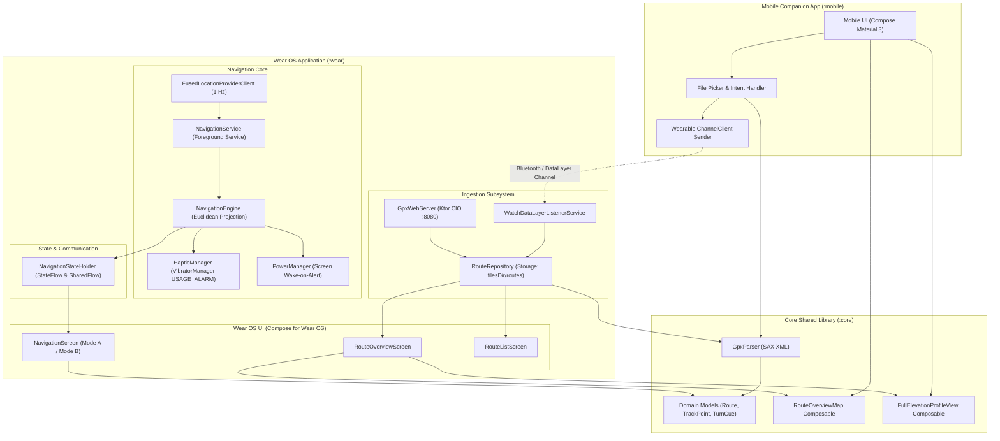

# SimpleRoute Architecture

## 1. System Overview and Core Goals

SimpleRoute is a turn-by-turn cycling navigation system engineered specifically for Wear OS smartwatches (API 30+) paired with an Android companion application. The system is optimized for BRouter GPX routes generated with OsmAnd turn instruction mode (turnInstructionMode = 3).

### Architectural Goals

- Standalone and Offline-First: Once a route is loaded onto the watch, navigation runs entirely on-device without requiring a paired phone, cellular network, or active Bluetooth connection.
- OLED and Battery Preservation: The watch interface enforces true black backgrounds (#000000) for OLED power reduction. When the watch enters ambient display mode, rendering drops to a 0.1 Hz update cycle via AmbientLifecycleObserver. The screen remains dimmed until approaching turn cues trigger dynamic wake events.
- Rider Tactile Safety: Glanceable visuals are paired with distinct vibration cadences generated through Android VibratorManager using USAGE_ALARM attributes. This ensures reliable cue recognition over road vibrations without requiring continuous rider gaze on the wrist.

---

## 2. Module Decomposition and Responsibilities

The codebase is organized into three Gradle modules:

```
SimpleRoute
|-- :core    (Shared models, parser, and UI components)
|-- :wear    (Wear OS standalone navigation application)
\-- :mobile  (Android companion application for ingestion and route transfer)
```

### Module `:core`

The `:core` module is an Android library providing reusable domain entities, file parsing, and canvas-based map composables shared across both platforms.

- Domain Models:
  - `Route`: Root data model containing metadata, track points, turn cues, waypoints, total distance, and elevation profile boundaries.
  - `TrackPoint`: Geo-coordinate representation (latitude, longitude, elevation, cumulative distance) along with Haversine distance and bearing calculation utilities.
  - `TurnCue`: Turn instruction point containing offset index in the trackpoint array, turn type, turn angle, text description, and distance from route start.
  - `TurnType` and `ManeuverCategory`: Enumerations classifying turns (Left, Right, Roundabout, U-Turn, Straight) and defining associated millisecond haptic pulse patterns and default angles.
  - `WayPoint`: Named navigational points of interest categorized as start, finish, or intermediate stops.
  - `RouteBounds`: Geographic bounding box computation with aspect-ratio preserving coordinate projectors for Compose Canvas rendering.
- GPX Parser (`GpxParser`):
  - Stream-based SAX XML parser hardened against XML external entity expansion.
  - Parses `<trkpt>` track sequences, `<rtept>` route cues with extensions, and `<wpt>` waypoints.
  - Computes cumulative distance, total ascent, total descent, and minimum/maximum elevations in a single sequential pass.
- Shared Compose Components:
  - `RouteOverviewMap`: Hardware-accelerated 2D canvas polyline renderer supporting directional flow chevrons, intermediate waypoints, and displaced start/finish badges for overlapping out-and-back tracks.
  - `FullElevationProfileView`: Downsampled elevation chart with smooth path rendering, vertical gradient fills, and distance/elevation scale markers.

### Module `:wear`

The `:wear` module is the standalone Wear OS application responsible for active route tracking, location processing, tactile alerting, and UI display.

- Foreground Navigation Service (`NavigationService`):
  - Runs as an ongoing Android foreground service with a partial wake lock to prevent CPU sleep during tracking.
  - Receives high-accuracy 1 Hz location updates through Google Play Services `FusedLocationProviderClient`.
  - Coordinates between the navigation engine, the haptic manager, and system screen wake locks.
- Navigation Engine (`NavigationEngine`):
  - Tracks rider progress along the route trackpoint array using a sliding window Euclidean nearest-point projection algorithm.
  - Computes cross-track error (off-route distance), remaining distance, and remaining time based on current speed.
  - Applies a dynamic 10-second alert rule: calculates warning distance as `effectiveSpeed * 10s` (clamped between 25 meters and 90 meters, defaulting to 4.5 m/s if speed falls below 1.0 m/s).
  - Emits `AlertEvent` instances exactly once per turn cue offset.
- Haptics Engine (`HapticManager`):
  - Translates `TurnType` into tactile patterns with alternating off/on timings:
    - Turn Left: Single weighted pulse [0, 500]
    - Turn Right: Two rapid tap pulses [0, 150, 100, 150]
    - Roundabout: Three-pulse rolling cadence [0, 100, 80, 100, 80, 250]
    - U-Turn: Rapid alarm flutter [0, 80, 50, 80, 50, 80]
    - Straight: Single crisp tap [0, 120]
  - Dispatches waveforms at maximum amplitude (255) using `VibrationAttributes.USAGE_ALARM` or `AudioAttributes.USAGE_ALARM` to guarantee execution in background and ambient states.
- Power and Display Management:
  - `AmbientLifecycleObserver` coordinates ambient mode transitions, switching views into high-contrast monochrome outlines and reducing recomposition frequency to 0.1 Hz.
  - Wake-on-Alert acquires a temporary `SCREEN_BRIGHT_WAKE_LOCK` with `ACQUIRE_CAUSES_WAKEUP` for 4 seconds when a turn cue alert triggers.
- Wear OS UI (`NavigationScreen`, `RouteOverviewScreen`, `RouteListScreen`):
  - Toggleable navigation displays: Mode A (vector turn arrow with remaining distance and street label) and Mode B (bearing-up breadcrumb route trail).
  - Docked dynamic elevation horizon showing 500 meters behind and 1500 meters ahead of the rider.
- Route Ingestion and Storage:
  - `RouteRepository`: Centralized route storage in the app private files directory (`filesDir/routes/`), with path traversal protection, sanitization, and pre-seeded bundled routes.
  - `WatchDataLayerListenerService`: Background service listening on Google Play Services Wearable DataLayer channel `/gpx-transfer` to accept routes streamed from the companion phone.
  - `GpxWebServer`: Embedded Ktor CIO HTTP server on port 8080 with PIN authentication, allowing direct Wi-Fi browser route uploads when a phone companion is not used.

### Module `:mobile`

The `:mobile` module is an Android phone companion application built with Jetpack Compose Material 3 for ingesting, inspecting, and transferring GPX files to the watch.

- Intent Handling and File Ingestion:
  - Intercepts incoming GPX files through Android share sheets (`Intent.ACTION_SEND`, `Intent.ACTION_VIEW`) and the system document picker (`ActivityResultContracts.OpenDocument`).
  - Resolves file descriptors, sanitizes names, and validates content length.
- Route Inspection and Preview:
  - Parses route data on an IO coroutine dispatcher using `:core` `GpxParser`.
  - Presents interactive statistics, full canvas route preview (`RouteOverviewMap`), and elevation profile (`FullElevationProfileView`).
- Wearable DataLayer Transfer:
  - Discovers connected Wear OS watches using Google Play Services `NodeClient`.
  - Opens a low-overhead binary streaming channel via `ChannelClient` (`/gpx-transfer/<fileName>`).
  - Streams raw GPX bytes directly to the watch file system with error reporting and progress status.

---

## 3. Data Flow and State Management

SimpleRoute relies on Kotlin Coroutines and StateFlow to maintain a reactive, unidirectional data flow across components.

```
+-------------------------------------------------------------+
|                      GPS Hardware                           |
+-------------------------------------------------------------+
                              | (1 Hz updates)
                              v
+-------------------------------------------------------------+
|                  FusedLocationProviderClient                |
+-------------------------------------------------------------+
                              | LocationCallback
                              v
+-------------------------------------------------------------+
|                     NavigationService                       |
|  - Holds Partial WakeLock                                   |
|  - Processes GPS coordinates via NavigationEngine           |
+-------------------------------------------------------------+
         |                                           |
         | (Updates state)                           | (Alert triggered)
         v                                           v
+-----------------------------+             +-----------------+
|    NavigationStateHolder    |             |  HapticManager  |
|  - StateFlow<NavigationState>|             |  - Alarm pulses |
|  - SharedFlow<AlertEvent>   |             +-----------------+
+-----------------------------+                      |
         |                                           v
         | (Collects state)                 +-----------------+
         v                                  | PowerManager    |
+-----------------------------+             | - Screen Wake   |
|   Wear Compose UI           |             +-----------------+
|  - Mode A (Turn Arrow)      |
|  - Mode B (Breadcrumb Map)  |
|  - Dynamic Elevation Horizon|
+-----------------------------+
```

### State Components

- `NavigationStateHolder`:
  - An application-scoped singleton serving as the decoupling boundary between `NavigationService` and the UI layer.
  - Exposes `navigationState: StateFlow<NavigationState>` containing the active route, rider coordinates, speed, bearing, distance remaining, distance to next cue, off-route cross-track error, and next turn cue.
  - Exposes `alertWakeEvents: SharedFlow<AlertEvent>` to signal single-shot screen wake and turn prompt actions.
  - Exposes lifecycle control methods (`startNavigation`, `stopNavigation`) that encapsulate Android foreground service intents.
- Route Repository Flow:
  - `RouteRepository.routeFilesFlow: StateFlow<List<File>>` automatically notifies the route selection screen when new GPX files arrive via Wi-Fi or Bluetooth DataLayer.

---

## 4. Architecture Diagram


