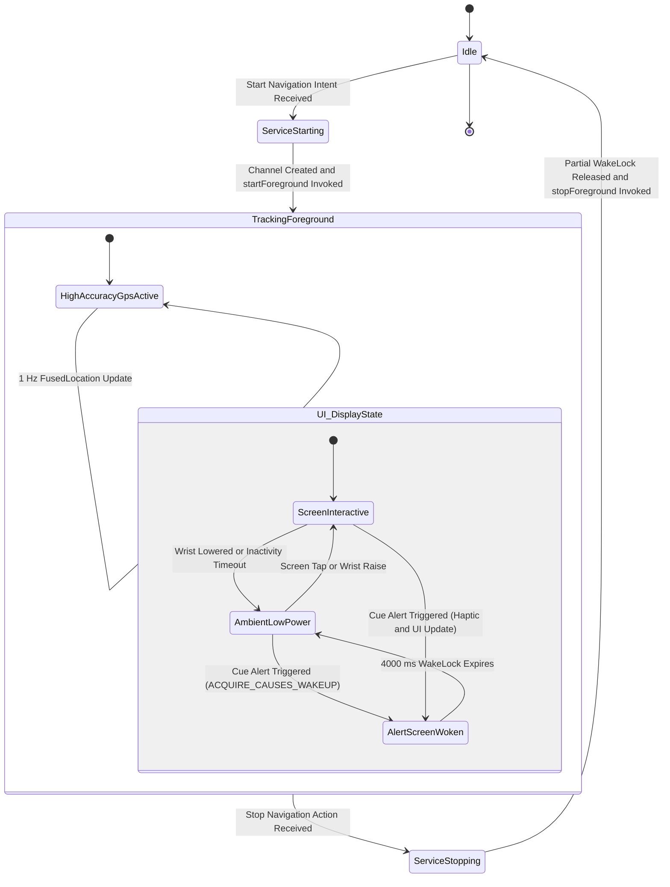

# Foreground Service, Power Management, and Wear OS Lifecycle

This document describes the foreground service architecture, Android power management, and Wear OS lifecycle implementation in SimpleRoute.

## 1. Purpose and Role of NavigationService

The `NavigationService` class manages active turn-by-turn cycling navigation on the watch. It executes as an ongoing foreground service to fulfill the following critical responsibilities:

- Continuous 1 Hz GPS tracking: Acquires high-accuracy position fixes through Google Play Services `FusedLocationProviderClient` with a 1000 ms update interval and zero distance threshold.
- Route matching and Euclidean projection: Projects raw GPS fixes onto the trackpoint array of the loaded GPX route using `NavigationEngine` to calculate remaining distance, elevation progress, off-track deviation, and progress toward upcoming cue points.
- Tactile and visual turn alerts: Dispatches multi-pulse directional vibration patterns through `HapticManager` and triggers wake events when the rider approaches within dynamic warning distance of an upcoming maneuver.
- Standalone execution: Operates independently of any connected smartphone or active Bluetooth link once the route GPX file is stored on the watch.

## 2. Android Requirements and Official Documentation

Android enforces strict policies on background operations, location tracking, and power consumption. SimpleRoute adheres to the official standards through the following platform requirements:

- Foreground Services Overview: Android requires any continuous background execution perceptible to the user to run as a foreground service with an ongoing user notification.
  Official guide: [Foreground services overview](https://developer.android.com/develop/background-work/services/foreground-services)
- Foreground Service Types (Location): Starting with Android 10 (API 29) and Android 14 (API 34), services accessing location in the background must explicitly declare the `location` foreground service type in the manifest and specify it when calling `startForeground`.
  Official guide: [Foreground service types (location)](https://developer.android.com/develop/background-work/services/fg-service-types#location)
- Location Permissions: Continuous GPS tracking requires explicit runtime grants of `ACCESS_FINE_LOCATION` and `ACCESS_COARSE_LOCATION`, alongside notification permission on Android 13+ (API 33+).
  Official guide: [Request location permissions](https://developer.android.com/training/location/permissions)
- Wear OS Ambient Mode: Wear OS enters ambient mode when the wrist drops or the screen times out to save battery. Apps displaying active information must observe ambient lifecycle transitions and reduce redraw frequency to 0.1 Hz or lower.
  Official guide: [Wear OS Ambient Mode](https://developer.android.com/training/wearables/views/always-on)
- Keep Device Awake with WakeLock: To prevent the application processor from entering deep sleep during active tracking, the system requires an explicit partial wake lock.
  Official guide: [Keep the device awake with WakeLock](https://developer.android.com/training/scheduling/wakelock)

## 3. Code Configuration References

The table below summarizes where each platform requirement is implemented within the codebase:

| Requirement | Target File | Line References | Description |
| :--- | :--- | :--- | :--- |
| Permissions and Types | `wear/src/main/AndroidManifest.xml` | Lines 4-9 | Declares `WAKE_LOCK`, `ACCESS_FINE_LOCATION`, `ACCESS_COARSE_LOCATION`, `FOREGROUND_SERVICE`, `FOREGROUND_SERVICE_LOCATION`, and `POST_NOTIFICATIONS`. |
| Standalone Watch App | `wear/src/main/AndroidManifest.xml` | Lines 35-37 | Declares `com.google.android.wearable.standalone` meta-data as `true`. |
| Activity Screen Wake | `wear/src/main/AndroidManifest.xml` | Lines 43-44 | Declares `showWhenLocked="true"` and `turnScreenOn="true"` for `MainActivity`. |
| Service Declaration | `wear/src/main/AndroidManifest.xml` | Lines 53-56 | Defines `NavigationService` with `exported="false"` and `foregroundServiceType="location"`. |
| Service Launch | `wear/src/main/java/dk/jehaj/simpleroute/navigation/NavigationStateHolder.kt` | Lines 31-37 | Launches service via `ContextCompat.startForegroundService`. |
| Notification Channel | `wear/src/main/java/dk/jehaj/simpleroute/service/NavigationService.kt` | Lines 194-205 | Creates `navigation_channel` with `IMPORTANCE_LOW` and disabled notification vibration. |
| Ongoing Notification | `wear/src/main/java/dk/jehaj/simpleroute/service/NavigationService.kt` | Lines 207-242 | Builds persistent notification with `CATEGORY_NAVIGATION`, `PRIORITY_LOW`, single-top activity intent, and Stop Ride action. |
| Foreground Promotion | `wear/src/main/java/dk/jehaj/simpleroute/service/NavigationService.kt` | Lines 244-247 | Calls `startForeground` with `FOREGROUND_SERVICE_TYPE_LOCATION`. |
| Notification Updates | `wear/src/main/java/dk/jehaj/simpleroute/service/NavigationService.kt` | Lines 249-253 | Updates notification text with distance and upcoming cue information on each location update. |
| 1 Hz GPS Updates | `wear/src/main/java/dk/jehaj/simpleroute/service/NavigationService.kt` | Lines 118-128 | Requests updates using `Priority.PRIORITY_HIGH_ACCURACY` with 1000 ms interval and 0 m distance threshold. |
| Partial Wake Lock | `wear/src/main/java/dk/jehaj/simpleroute/service/NavigationService.kt` | Lines 62-69 | Acquires non-reference-counted `PARTIAL_WAKE_LOCK` named `SimpleRoute:NavWakeLock` with a 6-hour safety timeout. |
| Partial Wake Lock Release | `wear/src/main/java/dk/jehaj/simpleroute/service/NavigationService.kt` | Lines 182-184, 259-261 | Releases wake lock safely during navigation stop and service destruction. |
| Screen Wake on Alert | `wear/src/main/java/dk/jehaj/simpleroute/service/NavigationService.kt` | Lines 165-176 | Acquires temporary `SCREEN_BRIGHT_WAKE_LOCK or ACQUIRE_CAUSES_WAKEUP` for 4000 ms upon reaching turn cue threshold. |
| Activity Wake on Alert | `wear/src/main/java/dk/jehaj/simpleroute/presentation/MainActivity.kt` | Lines 128-133, 153-170 | Listens to alert events from `NavigationStateHolder` and brings the display out of ambient state for 4000 ms. |
| Ambient Lifecycle Observer | `wear/src/main/java/dk/jehaj/simpleroute/presentation/MainActivity.kt` | Lines 53-71, 119 | Observes ambient transitions via `AmbientLifecycleObserver` and throttles update ticks to 0.1 Hz via `onUpdateAmbient`. |

## 4. Wear OS Specific Considerations

### 4.1 Samsung Galaxy Watch Power Management

Smartwatches operating on Wear OS (such as the Samsung Galaxy Watch4, Watch5, and Watch6) employ strict power saving policies:

- CPU Sleep Prevention: The application processor will suspend background computation within seconds of the display turning off unless a `PARTIAL_WAKE_LOCK` is held. SimpleRoute holds a non-reference-counted partial wake lock in `NavigationService` for the duration of the ride to ensure uninterrupted 1 Hz location processing.
- Six-Hour Safety Timeout: To prevent battery exhaustion if a rider forgets to stop navigation after a ride, the partial wake lock acquisition specifies a maximum duration of 21,600,000 ms (6 hours).
- AMOLED Display Optimization: Wear OS displays use OLED panels where black pixels consume zero power. SimpleRoute enforces a pure black background (`#000000`) across all navigation screens to minimize screen energy consumption.
- Ambient Mode Throttling: When the screen drops into ambient mode, `MainActivity` throttles visual updates through `AmbientLifecycleObserver`. Sensor processing continues at 1 Hz in the background service, while Compose UI recompositions drop to 0.1 Hz (once every 10 to 60 seconds), avoiding display processor wakeups until a turn alert occurs.
- Screen Wake on Alert: The display remains dimmed or off along straight route sections. When `NavigationEngine` signals an alert event, the app wakes the display for 4000 ms using `ACQUIRE_CAUSES_WAKEUP`, allowing the rider to glance at the wrist without manual interaction.

### 4.2 Coexistence with Fitness Tracking Apps

Cyclists frequently run dedicated fitness recorders like Samsung Health, Strava, or Garmin simultaneously with navigation:

- Shared Location Provider: Google Play Services `FusedLocationProviderClient` multiplexes GPS hardware fixes across all active client processes. SimpleRoute receiving 1 Hz location updates does not block or conflict with Samsung Health tracking workout distance, speed, or heart rate.
- Non-Intrusive Notifications: The ongoing notification uses `IMPORTANCE_LOW` and `PRIORITY_LOW` with vibrations disabled. This prevents SimpleRoute from overriding workout split announcements or incoming calls from other applications.
- Haptic Independence: Haptic patterns use Android `VibratorManager` directly with distinct wave patterns for left, right, roundabout, and U-turn maneuvers. These short bursts do not disrupt ongoing sensor recording by Samsung Health.

### 4.3 Standalone Execution Architecture

SimpleRoute is designed as a standalone watch application:

- Manifest Independence: The manifest metadata `com.google.android.wearable.standalone` is configured to `true`.
- Local Processing Pipeline: While GPX route files can be sent from the companion phone over Wearable `ChannelClient` or downloaded via the local Wi-Fi web server, navigation execution is 100 percent local. The GPS sensor, projection math, cue detection, haptic generation, and rendering pipeline execute exclusively on watch hardware without requiring network access or phone tethering.

## 5. Lifecycle and State Diagram

The following diagram illustrates the interaction between `NavigationService`, the foreground lifecycle, ambient mode transitions, and screen wake triggers:

