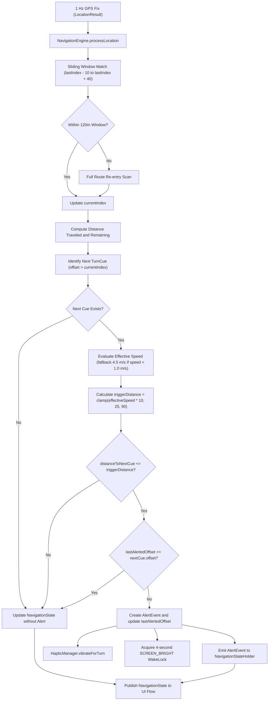

# Navigation Engine, Tracking, and Alerting

## 1. Overview

SimpleRoute executes real-time cycling navigation directly on Wear OS. The navigation subsystem runs inside `NavigationService` as an ongoing foreground service, receiving 1 Hz location fixes from `FusedLocationProviderClient`. State calculation, route projection, and alert evaluation are handled by `NavigationEngine`. Haptic alerts and screen wake events are dispatched when approaching route maneuvers.

---

## 2. Position Tracking and Track Projection

GPS fixes received on the watch are matched against the preloaded route trackpoint sequence using a sliding window Euclidean projection algorithm.

### Sliding Window Projection
Trackpoint lookups avoid full route traversal during ordinary cycling to minimize CPU and battery usage:
- Search Window: Evaluates trackpoints from index `max(0, currentIndex - 10)` to `min(lastIndex, currentIndex + 40)`.
- Metric: Evaluates distance between the GPS coordinate and each candidate trackpoint using spherical distance calculations. The candidate with the smallest distance becomes the new `currentIndex`.
- Route Re-entry Fallback: If the minimum distance within the local window exceeds 120.0 meters and unvisited trackpoints remain ahead, the engine initiates a full route scan across all indices. This allows the rider to rejoin the route after an off-track detour or missed turn.

### Progress Metrics
From the matched trackpoint index, the engine calculates:
- Off-Route Distance: The distance in meters from the raw GPS coordinate to the closest matched trackpoint on the route.
- Distance Traveled: The precomputed cumulative track distance stored at the matched trackpoint.
- Distance Remaining: The total route distance minus distance traveled, clamped to a minimum of 0.0 meters.
- Distance to Next Cue: Identified by finding the first turn cue whose trackpoint offset is greater than the current index. The distance is calculated as `nextCue.distanceFromStartMeters - distanceTraveled`.

---

## 3. Dynamic 10-Second Alert Rule

SimpleRoute provides predictive turn alerts based on cyclist speed rather than a static distance threshold.

### Speed Evaluation and Fallback
- When riding at or above 1.0 m/s, the engine uses the GPS speed fix directly.
- If GPS speed drops below 1.0 m/s (such as when stopping at red lights or navigating tight intersections), the engine applies a fallback cycling speed of 4.5 m/s (approximately 16 km/h).

### Trigger Distance Formula
The trigger distance targets a 10-second warning horizon and is clamped within safety bounds:

```text
effectiveSpeed = if (speedMps < 1.0) 4.5 else speedMps
triggerDistance = clamp(effectiveSpeed * 10.0, min = 25.0, max = 90.0)
```

- Minimum Clamp (25 m): Prevents late alerts during slow hill climbs or low-speed maneuvers.
- Maximum Clamp (90 m): Prevents premature alerts during high-speed descents that could cause confusion at earlier junctions.

### One-Shot Alert Firing
To prevent continuous or duplicate vibrations while traveling inside the trigger zone:
- An alert is fired only when `distanceToNextCue <= triggerDistance` and `lastAlertedOffset != nextCue.offset`.
- Once triggered, `lastAlertedOffset` records the cue offset. Subsequent location updates targeting the same cue are ignored.
- As soon as the rider passes the turn junction, the current track index surpasses the cue offset, advancing `nextCue` to the following maneuver and re-arming alert detection.

---

## 4. Directional Haptic Patterns

The watch delivers directional tactile cues using the device vibration subsystem via `HapticManager`.

### VibratorManager and Vibration Attributes
- API 31+ Devices: Accesses system vibration via `VibratorManager.defaultVibrator`.
- Older API Levels: Falls back to direct `Vibrator` system service.
- Amplitude Modulation: Active pulses use explicit maximum amplitude (255) so vibrations remain sharp and perceptible through cycling gloves and road vibration.
- Power and Background Delivery: Uses `VibrationAttributes.USAGE_ALARM` on Android 13+ (API 33+) and `AudioAttributes.USAGE_ALARM` on API 30 to 32. This prevents Android from suppressing navigation haptics during ambient mode, background execution, or screen-off states.

### Vibration Timing Arrays
Waveforms alternate between off and on durations measured in milliseconds:

- Turn Left (TL, TSLL, TSHL, KL): Single long weighted pulse
  Pattern: `[0, 500]`
- Turn Right (TR, TSLR, TSHR, KR): Two crisp rapid tap pulses
  Pattern: `[0, 150, 100, 150]`
- Roundabout (RNDB): Three rolling cadence pulses
  Pattern: `[0, 100, 80, 100, 80, 250]`
- U-Turn (TU): Rapid alarm flutter pulses
  Pattern: `[0, 80, 50, 80, 50, 80]`
- Straight or Continue (C): Single short confirmation pulse
  Pattern: `[0, 120]`

---

## 5. UI Visualization Modes

`NavigationScreen` coordinates visual presentation, rendering against a pure black background (`#000000`) for OLED power efficiency. Users toggle between primary visualization modes via single tap or horizontal swipe gestures.

### TurnArrowView (Mode A: Vector Turn Arrow)
- Center Canvas: Renders an angled vector arrow matching the turn angle from BRouter cues, or a circular roundabout graphic showing the designated exit path.
- Styling: Drawn in cyan (`#00E5FF`) during active mode, switching to high-contrast white with reduced stroke thickness in ambient mode.
- Context Text: Shows the maneuver instruction or street name below the arrow.

### BreadcrumbMapView (Mode B: Bearing-Up Polyline Map)
- Rotating Canvas: Rotates by `-currentBearingDeg` so the direction of travel always points straight up on the round display.
- Track History: The completed trail is rendered in subdued slate gray (`#455A64`) during active mode and hidden during ambient mode.
- Upcoming Trail: High-contrast cyan polyline with directional path chevrons spaced at regular intervals.
- Waypoints: Turn cues along the active slice are displayed as yellow circular nodes (`#FFD54F`).
- Rider Indicator: A fixed chevron centered on screen with an illuminated aura in active mode, transitioning to an outline in ambient mode.

### ElevationProfileView (Bottom-Docked 2D Horizon Profile)
- Screen Placement: Docked at the bottom, occupying approximately 32% of screen height where round displays provide maximum horizontal width.
- Window Bounds: Spans a 2000-meter window consisting of 500 meters behind and 1500 meters ahead of the rider.
- Rider Pinning: The rider marker is horizontally fixed at exactly 25% width (`500m / 2000m`), providing visual anticipation of upcoming climbs and descents.
- Dynamic Scaling: Uses a minimum vertical elevation span of 20 meters to prevent flat roads from rendering as jagged elevation peaks.
- Power Optimization: The gradient fill beneath the profile line is disabled in ambient mode, retaining only the path stroke.
- Current Elevation: Centered text display showing current altitude in meters.

---

## 6. Location Processing and Alert Dispatch

The following flowchart illustrates the processing pipeline for each 1 Hz location fix.


