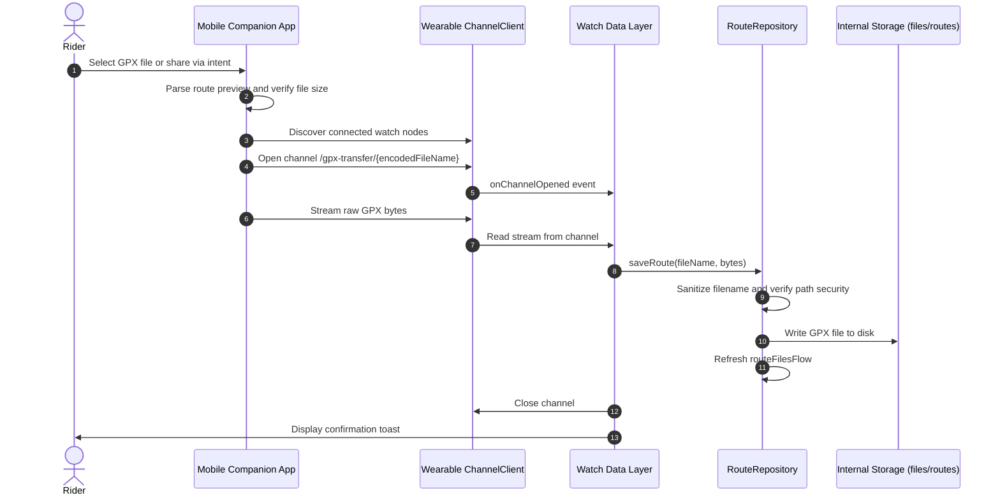
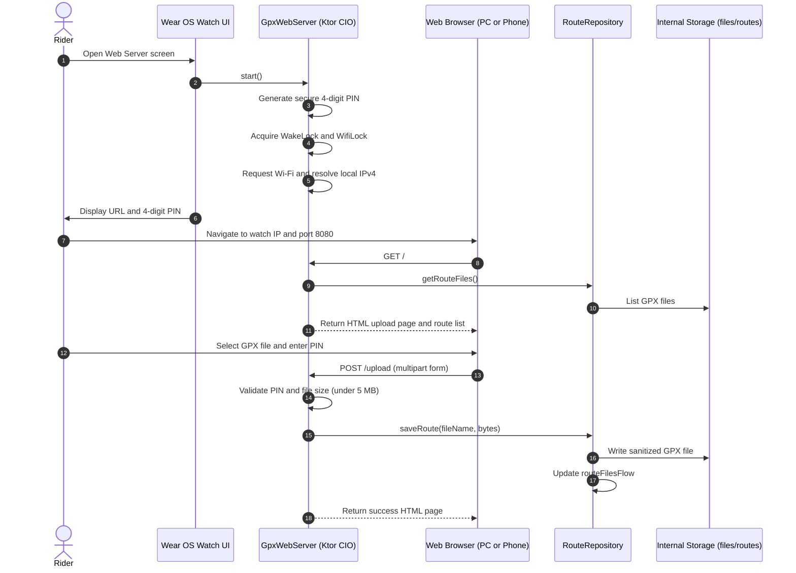

# GPX Ingestion and Route Transfer Pipeline

This document describes the GPX ingestion architecture, route data contracts, transfer pathways, and storage management in SimpleRoute.

---

## 1. GPX Route Contract

SimpleRoute requires standard GPX 1.1 files with routing hints optimized for turn-by-turn cycling navigation. The canonical source is BRouter-web configured with turn instructions enabled.

### 1.1 BRouter Format and Turn Instruction Mode
- SimpleRoute expects files generated with `turnInstructionMode = 3` (OsmAnd mode).
- In this mode, BRouter outputs both the high-resolution breadcrumb coordinate trail (`<trk>`) and explicit turn cues (`<rtept>`) inside the same GPX document.
- Waypoints (`<wpt>`) are parsed when present to identify named destinations, start points, finish points, or user markers.

### 1.2 Track Point Parsing and Distance Calculation
The parser processes track points sequentially from `<trk>` -> `<trkseg>` -> `<trkpt>`:
- **Attributes**: Latitude (`lat`) and longitude (`lon`) parsed from XML attributes as 64-bit floating point values.
- **Elevation**: Extracted from child element `<ele>`. Defaults to 0.0 if omitted.
- **Cumulative Distance**: Calculated point-to-point along the track array using the Haversine great-circle formula:
  - Earth radius constant: 6,371,000 meters.
  - Each point records its total distance from route origin in meters.
- **Elevation Statistics**:
  - Positive elevation differences accumulate into total ascent.
  - Negative elevation differences accumulate into total descent.
  - Minimum and maximum route elevations are tracked during parsing.
- **Security**: The SAX parser factory explicitly disallows external entity resolution (XXE) and external DTD loading to protect against entity expansion exploits. Text content buffers enforce a maximum length cap of 16,384 characters per node.

Example track point XML structure:
```xml
<trk>
  <name>Brendstrup - Aarhus</name>
  <trkseg>
    <trkpt lat="56.18312" lon="10.15543">
      <ele>72.5</ele>
    </trkpt>
    <trkpt lat="56.18345" lon="10.15589">
      <ele>73.0</ele>
    </trkpt>
  </trkseg>
</trk>
```

### 1.3 Turn Cue Parsing and Offset Mapping
Turn maneuvers are extracted from `<rtept>` elements:
- **Turn Code (`<turn>`)**: BRouter mnemonic string indicating the maneuver. Supported codes include:
  - Left maneuvers: `TL` (Turn Left), `TSLL` (Slight Left), `TSHL` (Sharp Left), `KL` (Keep Left).
  - Right maneuvers: `TR` (Turn Right), `TSLR` (Slight Right), `TSHR` (Sharp Right), `KR` (Keep Right).
  - Special maneuvers: `RNDB` (Roundabout), `TU` (U-Turn), `C` (Continue straight), `UNKNOWN`.
- **Turn Angle (`<turn-angle>`)**: Relative change in heading in degrees. If missing in the GPX payload, default directional angles are applied (-90 degrees for `TL`, +90 degrees for `TR`, 180 degrees for `TU`, 0 degrees for `C` and `RNDB`).
- **Offset Index (`<offset>`)**: Integer matching the exact zero-based index of the target track point in the `<trkpt>` array.
  - Cues are sorted by this offset.
  - Each cue derives its distance from the start of the route by querying the cumulative distance of the corresponding track point.
  - Clamping (`coerceIn(0, lastIndex)`) protects against corrupted or out-of-bounds offsets.
- **Description (`<desc>`)**: Human-readable instruction string presented on the watch turn card.

Example route point XML structure:
```xml
<rtept lat="56.18345" lon="10.15589">
  <desc>Turn left onto Brendstrupvej</desc>
  <extensions>
    <turn>TL</turn>
    <turn-angle>-88.0</turn-angle>
    <offset>1</offset>
  </extensions>
</rtept>
```

### 1.4 Waypoint Parsing
Waypoints are parsed from `<wpt>` tags into `WayPoint` objects:
- Fields include `name`, `lat`, `lon`, `ele`, `type`, and `desc`.
- First and last waypoints or types matching `start` and `end` are highlighted in companion route previews and watch summaries.

---

## 2. Route Transfer Pathways

SimpleRoute provides three independent pathways to ingest GPX routes onto the watch. In all cases, files end up stored in the watch internal application storage and can be used completely offline.

### 2.1 Primary Pathway: Wearable ChannelClient
The primary transfer mechanism transfers GPX files from the companion Android phone to the watch over Bluetooth or Wi-Fi peer-to-peer using the Google Play Services Wearable Data Layer.

1. **Companion Selection**:
   - The rider selects a GPX file via the system document picker (`OpenDocument` contract) or shares a route directly to SimpleRoute from BRouter, OsmAnd, or a file manager (`ACTION_SEND` or `ACTION_VIEW`).
   - The companion app verifies that file size does not exceed the 10 MB transfer threshold.
   - The companion previews route geometry, distance, elevation profile, and waypoints before sending.
2. **Channel Opening**:
   - The phone queries connected watch nodes using `Wearable.getNodeClient(context).connectedNodes`.
   - It targets the primary node and opens a binary channel with the path `/gpx-transfer/{encodedFileName}`.
3. **Data Streaming**:
   - The phone streams raw file bytes into the channel output stream and flushes upon completion.
4. **Watch Reception**:
   - Both `WatchDataLayerListenerService` (background listener service) and `MainActivity` (foreground channel callback) listen for channel open events with paths starting with `/gpx-transfer`.
   - The watch reads all bytes from the channel input stream, closes the channel, and saves the file via `RouteRepository.saveRoute(fileName, bytes)`.
   - A short toast notification confirms arrival on the watch face.

### 2.2 Secondary Pathway: Embedded Ktor CIO HTTP Server
For standalone watch use without an Android phone, the watch hosts an internal web server over local Wi-Fi.

1. **Server Initialization**:
   - The rider opens the Web Server screen in the watch settings menu.
   - `GpxWebServer` starts an embedded Ktor HTTP server powered by the CIO coroutine-based engine listening on port 8080.
   - A cryptographically secure 4-digit PIN is generated via `SecureRandom` and shown on the watch display.
2. **Radio Management**:
   - A partial `WakeLock` is acquired with a 15-minute safety timeout to prevent CPU sleep during transfer.
   - A `WifiLock` in `WIFI_MODE_FULL_HIGH_PERF` mode is acquired to keep the watch Wi-Fi radio active.
   - An explicit Wi-Fi network request is registered with `ConnectivityManager` to ensure Wear OS does not fall back to Bluetooth proxy mode.
3. **LAN Addressing**:
   - The server queries network interfaces, prioritizing `wlan0` to identify the watch local IPv4 address.
   - The full access URL (for example `http://192.168.1.145:8080`) is presented on the watch screen.
4. **Web Interface and Endpoints**:
   - `GET /`: Serves an HTML page featuring the list of currently installed routes, route deletion controls, and a file upload form.
   - `POST /upload`: Accepts multipart form uploads containing the 4-digit PIN and GPX file:
     - Enforces a 5 MB file size limit per upload.
     - Validates the submitted PIN against the ephemeral session PIN.
     - Implements brute-force defense: five consecutive failed PIN submissions lock out further attempts for 60 seconds.
     - Writes the verified GPX file to the repository.
   - `POST /delete`: Accepts form parameters containing the PIN and target file name to delete an existing route directly from the browser.
5. **Teardown**:
   - When the user exits the screen or toggles the server off, the HTTP engine stops, locks are released, and network callbacks are unregistered.

### 2.3 Direct Pathway: Android Debug Bridge (ADB)
During development or manual provisioning, GPX files can be pushed directly to the app internal storage directory over USB or Wi-Fi debugging:

Push command pattern:
```bash
adb push route.gpx /sdcard/
adb shell run-as dk.jehaj.simpleroute cp /sdcard/route.gpx files/routes/
```

Target location:
`/data/data/dk.jehaj.simpleroute/files/routes/`

---

## 3. Route Storage and Repository Management

The `RouteRepository` class acts as the single source of truth for route file management on Wear OS.

### 3.1 Directory Structure
Routes are stored as separate `.gpx` files in the app internal files directory:
`context.filesDir/routes/`

Because this directory is inside private internal storage:
- No runtime storage permissions are required on Android 11+ (API 30+).
- Stored routes cannot be inspected or altered by other apps.
- All stored routes remain available while offline.

### 3.2 Path Traversal and Sanitization
To prevent path traversal attacks during file upload or channel transfers:
- File names are sanitized through `sanitizeFileName`:
  - Path delimiters (`/` and `\`) are stripped.
  - Characters outside `[a-zA-Z0-9._-]` are converted to underscores.
  - Leading dots are removed to prevent hidden files.
  - The `.gpx` extension is strictly enforced.
- Target paths are validated using canonical path comparison:
  ```kotlin
  val baseCanonical = routesDir.canonicalFile.toPath()
  val targetCanonical = file.canonicalFile.toPath()
  if (!targetCanonical.startsWith(baseCanonical)) {
      throw SecurityException("Path traversal attempt detected")
  }
  ```

### 3.3 Default Asset Seeding
On first launch, `ensureInitialRoutes()` checks the shared preferences key `initial_routes_seeded`. If no routes exist and the app has not previously completed seeding, it copies any sample GPX files found in bundled assets (`assets/routes/*.gpx`) into `filesDir/routes/`.

### 3.4 Reactive File Listing and Memory Model
- `routeFilesFlow: StateFlow<List<File>>` emits the current list of route files sorted alphabetically whenever a file is saved or deleted.
- Route models are not kept perpetually in RAM. Large routes with thousands of track points are parsed on demand inside `loadRoute(file)` on `Dispatchers.IO` when selected for navigation or overview, preserving memory on Wear OS devices.

---

## 4. Transfer Sequence Diagrams

### 4.1 Phone-to-Watch ChannelClient Flow



### 4.2 Wi-Fi Browser Upload Flow


